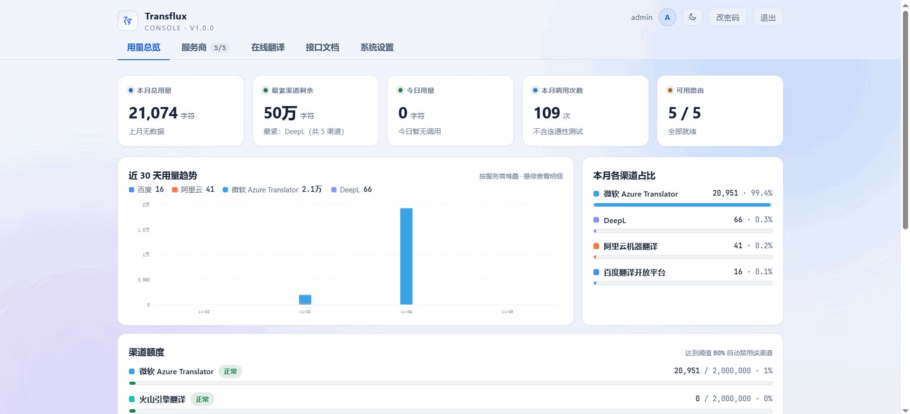

# Transflux

多上游统一翻译网关：对外暴露 Azure / OpenAI / Claude 等兼容接口，内部在百度 / 阿里云 / 火山引擎 / Azure / DeepL 之间按优先级或均衡消耗路由，自带用量计量、额度管控与可视化后台。



## 快速开始（Docker）

镜像：`ghcr.io/no-token/transflux:latest`

```bash
# 1. 准备数据目录（容器内以 uid 1000 运行，目录必须可写）
mkdir -p /opt/transflux/data && chown -R 1000:1000 /opt/transflux/data

# 2. 启动
docker run -d --name transflux \
  -p 3000:3000 \
  -v /opt/transflux/data:/app/data \
  -e CORS_ORIGINS=https://your-app.example.com \
  --restart unless-stopped \
  ghcr.io/no-token/transflux:latest
```

- 改端口改 `-p` 左侧；改跨域改 `CORS_ORIGINS`（逗号分隔 origin）；**改完重跑同一条命令即可**
- `MASTER_KEY` 可不传：自动生成 `data/.master.key` 并随卷持久化（多实例部署才需要显式传，`openssl rand -hex 32` 生成）
- 数据库、密钥都在 `/opt/transflux/data`，**备份此目录 = 完整迁移**

然后：

1. 打开 `http://服务器IP:3000/admin`，默认 `admin / admin123`，**首次登录强制改密**
2. 「服务商」填入各上游 API 密钥，「系统设置」修改网关密钥

- **升级 / 回滚**：换镜像 tag 后完整重跑即可（数据在挂载目录里，不受影响）：

  ```bash
  # 1. 拉取目标版本（升级用 :latest，回滚把 tag 换成旧版本号如 :1.0.0）
  docker pull ghcr.io/no-token/transflux:latest

  # 2. 删除旧容器
  docker rm -f transflux

  # 3. 重新启动（与首次部署的启动命令相同）
  docker run -d --name transflux \
    -p 3000:3000 \
    -v /opt/transflux/data:/app/data \
    -e CORS_ORIGINS=https://your-app.example.com \
    --restart unless-stopped \
    ghcr.io/no-token/transflux:latest
  ```
- **生产 TLS**：前置 nginx 反代（示例）：

  ```nginx
  server {
      listen 443 ssl;
      server_name gw.example.com;
      ssl_certificate     /etc/nginx/certs/gw.pem;
      ssl_certificate_key /etc/nginx/certs/gw.key;
      location / {
          proxy_pass http://127.0.0.1:3000;
          proxy_set_header Host $host;
          proxy_set_header X-Forwarded-For $proxy_add_x_forwarded_for;
          proxy_buffering off;   # 渠道流式输出（OpenAI/Claude SSE）需要
      }
  }
  ```

## 环境变量

| 变量 | 说明 |
|---|---|
| `CORS_ORIGINS` | 跨域白名单，逗号分隔完整 origin，留空不启用 |
| `MASTER_KEY` | 64 位 hex，加密数据库中的上游密钥；不传自动生成文件并随卷持久化 |
| `AUTH_KEY` | 网关密钥的首次建库初始值（之后以「后台 → 系统设置」为准，可不传） |

## 调用示例

```bash
curl -X POST "http://localhost:3000/translate?api-version=3.0&to=zh" \
  -H "Ocp-Apim-Subscription-Key: 网关密钥" \
  -H "Content-Type: application/json" \
  -d "[{\"Text\":\"hello world\"}]"
```

- 强制指定上游：`?provider=azure`（渠道名或实例名）
- 用量查询：`GET /usage?month=2026-01`
- 翻译缓存默认开启：命中不打上游、不计额度（响应头 `X-Cache: HIT/MISS`），后台可开关、清空、看统计

## 渠道列表

每个渠道有独立文档页（可在后台启停），密钥统一为网关密钥：

| 渠道 | 端点 | 文档页 | 适用客户端 |
|------|------|--------|-----------|
| Azure 兼容 | `POST /translate`、`/azure/translate` | `/azure` | Azure SDK、沉浸式翻译「Azure 机器翻译」 |
| 百度兼容 | `POST /baidu/api/trans/vip/translate` | `/baidu` | 百度通用翻译 SDK / 既有代码 |
| 自定义 API | `POST /imme?token=网关密钥` | `/imme` | 沉浸式翻译「自定义 API」（ImmersiveL 协议） |
| DeepLX | `POST /deeplx/translate?token=网关密钥` | `/deeplx` | 沉浸式翻译 DeepLX、Bob、DeepLX 客户端 |
| Google 兼容 | `GET /google/translate_a/single?token=网关密钥` | `/google` | 沉浸式翻译「谷歌翻译」、Google 网页翻译客户端 |
| OpenAI 兼容 | `POST /v1/chat/completions` | `/openai` | 所有 OpenAI 兼容客户端（DeepSeek / Ollama / OpenRouter…） |
| Claude 兼容 | `POST /v1/messages` | `/claude` | Claude 协议客户端（LobeChat / Dify / Cherry Studio…），支持流式 |

### 上游服务商开通与免费额度

| 上游 | 开通 / 领取额度地址 | 免费额度 |
|------|---------------------|----------|
| 百度翻译 | [fanyi-api.baidu.com](https://fanyi-api.baidu.com/#) | 标准版免费使用（有 QPS 限制），注册即用 |
| Azure 翻译 | [Azure Translator 文档](https://learn.microsoft.com/zh-cn/azure/ai-services/translator/text-translation/how-to/use-rest-api?tabs=csharp) | F0 免费层每月 200 万字符，[Azure 门户](https://portal.azure.com)创建 Translator 资源时选 F0 |
| 阿里云机器翻译 | [aliyun.com/product/ai/alimt](https://www.aliyun.com/product/ai/alimt) | 开通后每月有免费额度，以控制台显示为准 |
| 火山引擎机器翻译 | [volcengine.com/product/machine-translation](https://www.volcengine.com/product/machine-translation) | 新用户有免费试用额度，以控制台显示为准 |
| DeepL | [deepl.com/zh/translator](https://www.deepl.com/zh/translator) | ⚠️ 原有的「每月刷新 50 万字符」API Free 计划已下架（Legacy）。现行 **API Developer** 计划仅提供**一次性 100 万字符**免费额度，用完即止，主要面向开发评估 |

> 每家额度独立、互不通用。后台「渠道额度」里填入各家的月度额度后，总览会显示每家的余量与告警状态。

## 沉浸式翻译接入

准备：网关可公网访问（下表以 `https://gw.example.com` 为例），网关密钥在「后台 → 系统设置」。

> **Beta 服务要先开启**：「自定义 API」和「DeepLX」在沉浸式翻译里默认隐藏。使用前先到 沉浸式翻译 → 设置 → **开发者设置** → 勾选「**启用 Beta 测试特性**」，翻译服务列表里才会出现这两个服务。

| 沉浸式翻译里的服务 | 接口地址 | API Key | 备注 |
|---|---|---|---|
| 自定义 AI（选 OpenAI）或 DeepSeek / Ollama 等 | `https://gw.example.com/v1/chat/completions` | 网关密钥 | **推荐**。模型随意填，支持流式；每秒请求数先设 1~2 |
| Claude | `https://gw.example.com/v1/messages` | 网关密钥 | 支持流式 |
| Azure 机器翻译 | `https://gw.example.com` | 网关密钥 | 地区留空；实测最稳 |
| 自定义 API ⚠️需开 Beta | `https://gw.example.com/imme?token=网关密钥` | — | Beta 开启后列表才会出现；语言码 `zh`/`en`/`zh-TW` 等 |
| DeepLX ⚠️需开 Beta | `https://gw.example.com/deeplx/translate?token=网关密钥` | — | Beta 开启后列表才会出现；「每次翻译段落数」建议 3 |
| 谷歌翻译（仅部分版本有 apiUrl 设置项） | `https://gw.example.com/google/translate_a/single?token=网关密钥` | — | 没有该项就用「自定义 API」 |

语言码：各服务按原生风格填即可（Azure `zh-Hans`、Google `zh-CN`、DeepL `ZH`、通用 `zh`/`en`/`ja`…），网关自动归一转换。常用别名：`ja`=`jp`、`ko`=`kor`、`fr`=`fra`、`es`=`spa`、粤语 `yue`、文言 `wyw`（DeepL 上游不支持后两者）。

## 备注

- 源码运行：`npm install && npm start`（Node ≥ 18）；自测：`npm run selftest`
- 上游密钥与网关密钥 AES-256-GCM 加密落库；`data/` 含数据库与主密钥，勿提交版本库或对外暴露
- License：MIT

## Star History

<a href="https://www.star-history.com/?repos=no-token%2Ftransflux&type=date&legend=top-left">
 <picture>
   <source media="(prefers-color-scheme: dark)" srcset="https://api.star-history.com/chart?repos=no-token/transflux&type=date&theme=dark&legend=top-left" />
   <source media="(prefers-color-scheme: light)" srcset="https://api.star-history.com/chart?repos=no-token/transflux&type=date&legend=top-left" />
   
 </picture>
</a>
